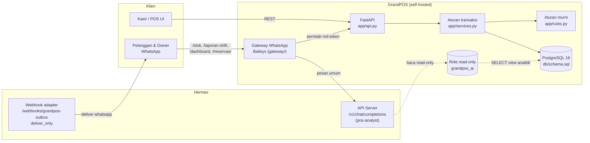

# GrandPOS — self-hosted POS platform (Grand Aceh Kuliner)

Referensi implementasi mandiri untuk POS restoran F&B khas Aceh + retail.
Seluruhnya berjalan lokal, tanpa Firebase.

## Ringkasan arsitektur



## Keputusan stack

- **Backend: FastAPI** (bukan Express). Alasan: transaksi multi-langkah
  dipetakan langsung ke `with conn.transaction()`, validasi input sudah
  terstruktur lewat Pydantic (`422` otomatis), dan `TestClient` mengizinkan
  pengujian kontrak HTTP tanpa server terpisah. Logika uang juga diuji di
  Python `Decimal` yang sama dengan yang dipakai SQL.
- **PostgreSQL 16** (bukan SQLite): penulis kasir/shift bersamaan,
  integritas ledger, dan operasi stok/member/vendor transaksional.
- **psycopg 3 dengan SQL eksplisit**, tanpa ORM. Semantik transaksi
  (`SELECT … FOR UPDATE`, satu commit per alur bisnis) ditulis terbuka.

## Struktur berkas

| Berkas | Isi |
|---|---|
| `db/schema.sql` | DDL lengkap: 18 tabel wajib + tabel ledger/pendukung, enum, indeks, FK/check/unique, trigger `updated_at`, 4 view analitik |
| `db/seed.sql` | `taqim2609` (SUPERADMIN, **nonaktif**), denah meja, menu Aceh, bahan, resep, member, promo |
| `db/bootstrap_superadmin.sql` | Bootstrap akun superadmin dari environment (tanpa password default) |
| `db/roles.sql` | Role read-only `grandpos_ai` + grant hanya ke view analitik |
| `db/migrations/0002_optimistic_lock.sql` | Migrasi idempoten: `version` pada `orders`/`shifts`, `shifts.cashier_id`, indeks laci per kasir |
| `docker-compose.yml` | PostgreSQL 16 + API, health check, volume persisten |
| `.env.example` | Seluruh kredensial lewat environment (placeholder) |
| `app/rules.py` | Aturan bisnis murni (harga berat, diskon, bagi hasil, kas, poin) |
| `app/services.py` | Layanan transaksional (order, bayar, void, shift, settlement) |
| `app/api.py` | REST API FastAPI |
| `app/db.py` | Koneksi, health check, query laporan allowlisted |
| `app/parsers.py` | Parser deterministik perintah WhatsApp (nol LLM) |
| `app/signing.py` | HMAC-SHA256 + proteksi replay |
| `app/guard.py` | Allowlist, rate limit, log aman |
| `app/outbox.py` | Payload struk & rekap shift |
| `app/outbox_delivery.py` | Enqueue best-effort (savepoint), jadwal backoff, klaim atomik worker |
| `scripts/outbox_worker.py` | Worker retry pengiriman WhatsApp (backoff + dedupe + kill-switch) |
| `gateway/` | Layanan Node/Baileys: parser, allowlist, outbox, verifikasi HMAC |
| `pos-analyst/SYSTEM_PROMPT.md` | System prompt `pos-analyst` |
| `docs/hermes-api-server.md` | Integrasi Hermes API Server (jalur AI) |
| `docs/hermes-webhook-outbox.md` | Integrasi webhook adapter + penandatanganan |
| `scripts/check_static.py` | Pemeriksaan statis SQL/compose/env + tes |

## Deployment

```bash
cp .env.example .env
# Isi POSTGRES_PASSWORD, DATABASE_URL, GRANDPOS_SUPERADMIN_PASSWORD,
# GRANDPOS_OUTBOX_SECRET. Jangan pernah commit .env.
docker compose config          # validasi
docker compose up -d --build
docker compose ps              # tunggu healthcheck hijau
```

Bootstrap superadmin (sekali, manual):

```bash
psql "$DATABASE_URL" -v pw="$GRANDPOS_SUPERADMIN_PASSWORD" \
  -f db/bootstrap_superadmin.sql
```

Migrasi/seed: `db/schema.sql`, `db/seed.sql`, `db/roles.sql` dimuat otomatis
oleh entrypoint PostgreSQL saat volume **belum** ada. Untuk volume yang sudah
ada, jalankan manual dengan `psql -f`.

## MCP server laporan (Business Analyst)

Server MCP di `app/mcp_server.py` (systemd `grandpos-mcp.service`, port 8001)
mengekspos tool **READ ONLY** untuk analis: snapshot hari ini (tool lama,
kompatibel) dan laporan historis berparameter (rentang tanggal, filter, paging,
totals stabil). Detail lengkap: `docs/mcp-reports.md`.

```bash
# uji unit tanpa DB
./venv_mcp/bin/python -m pytest tests/test_mcp_reports.py tests/test_mcp_server_tools.py -q
# uji terhadap DB lokal (read-only)
MCP_LIVE_DB=1 ./venv_mcp/bin/python -m pytest tests/test_mcp_live_db.py -q
# handshake MCP end-to-end pada instance sementara
./venv_mcp/bin/python scripts/mcp_live_check.py
```

Jika muncul `ImportError: cannot import name 'ArgsKwargs' from 'pydantic_core._pydantic_core'`,
interpreter venv (Python 3.11) sedang memuat `site-packages` milik Python lain lewat
`PYTHONPATH`. Jalankan ulang dengan `env -u PYTHONPATH PYTHONNOUSERSITE=1 ...`.

## Model pengiriman WhatsApp (thermal-first, outbox async)

Struk thermal adalah **sumber kebenaran**. WhatsApp hanya saluran sampingan:
kegagalan pengiriman tidak pernah membatalkan pembayaran atau tutup shift.

**Alur:**

1. Transaksi bisnis commit (bayar / void / tutup shift) — tidak pernah menunggu
   jaringan.
2. Baris `outbox_messages` ditulis **setelah** seluruh mutasi uang, di dalam
   `SAVEPOINT`. Gagal (INSERT error, payload builder error) → hanya savepoint
   yang di-rollback, transaksi induk tetap commit.
3. `scripts/outbox_worker.py` mengambil baris `status='pending'` dan POST ke
   webhook Hermes dengan header HMAC dari `app/signing.py`.

**Jadwal backoff** (`BACKOFF_SCHEDULE` / `MAX_ATTEMPTS` di
`app/outbox_delivery.py`) — 4 percobaan total:

| Percobaan gagal | Tunggu sebelum retry | Status setelah gagal |
|---|---|---|
| 1 | 60 detik | tetap `pending` |
| 2 | 5 menit | tetap `pending` |
| 3 | 15 menit | tetap `pending` |
| 4 | — | `failed` (parkir, tidak dikirim lagi) |

Baris baru (`attempts = 0`) dianggap jatuh tempo langsung. Worker mengklaim
baris dengan `attempts < MAX_ATTEMPTS`, jadi percobaan ke-4 tetap terjadi dan
kegagalannya yang memarkir baris.

**Dedupe:** `outbox_messages.dedupe_key` UNIQUE. Kunci `receipt:<order_id>` dan
`shift_recap:<shift_id>` — enqueue berulang dengan kunci sama berakhir
`ON CONFLICT DO NOTHING`, jadi satu struk = paling banyak satu kiriman WhatsApp.

**Konkurensi:** worker mengklaim dengan
`UPDATE … WHERE id IN (SELECT … FOR UPDATE SKIP LOCKED) RETURNING`.
Dua worker paralel tidak pernah mengklaim baris yang sama.

**Kill-switch `OUTBOX_ENABLED`:**

- `true` (default) — worker mengirim.
- `false` — worker tidak mengklaim/mengirim apa pun, tetapi POS **tetap**
  mengantrekan. Dipakai saat offline; antrean dikirim setelah flag dinyalakan.

**Menjalankan worker:**

```bash
# sekali jalan (mis. dari cron)
python3 scripts/outbox_worker.py --once
# loop terus-menerus
python3 scripts/outbox_worker.py
# uji tanpa mengirim (tidak memakai jatah percobaan; aman diulang)
python3 scripts/outbox_worker.py --once --dry-run
```

`--dry-run` memilih baris yang jatuh tempo dengan predikat yang sama seperti
klaim asli, tetapi **tidak** menaikkan `attempts`, jadi mengulanginya tidak
pernah membuat baris nyata tertahan di status `pending`.

Env: `DATABASE_URL`, `GRANDPOS_OUTBOX_URL`, `GRANDPOS_OUTBOX_SECRET`,
`OUTBOX_ENABLED`, `OUTBOX_POLL_SECONDS` (60), `OUTBOX_BATCH` (20).

## Degraded mode

Set `OFFLINE_MODE=true` untuk memaksa seluruh server ke mode offline (default
`false`). Terminal juga dapat mengirim `X-Terminal-Connectivity: online|offline`
pada setiap request. Mode efektif menjadi offline bila **server atau header**
menyatakan offline; header `online` tidak dapat mengesampingkan server offline.
Nilai saat ini tersedia lewat `GET /system/connectivity` sebagai `mode`,
`source`, dan `allowed_operations` agar POS dapat menonaktifkan tombol terkait.

| Operasi | Online | Offline |
|---|---|---|
| Buat order (`POST /orders`) | Diizinkan | Diizinkan |
| Bayar (`POST /orders/{id}/pay`) | Diizinkan | Diizinkan |
| Void (`POST /orders/{id}/void`) | Diizinkan | Diizinkan |
| Kas masuk (`POST /cash-movements`, `direction=in`) | Diizinkan | Diizinkan |
| Kas keluar (`POST /cash-movements`, `direction=out`) | Diizinkan | Diblokir (409) |
| Tutup shift (`POST /shifts/{id}/close`) | Diizinkan | Diblokir (409) |

Guard berada di lapisan API, sebelum koneksi/transaksi database dibuka; logika
pembayaran, void, rekonsiliasi, dan perhitungan kas di `app/services.py` tidak
diubah.

## Contoh endpoint

```bash
API=http://localhost:8000
curl -s $API/health
curl -s -X POST $API/shifts/open -H 'Content-Type: application/json' \
  -d '{"opening_float":500000,"opened_by":1}'
curl -s -X POST $API/orders -H 'Content-Type: application/json' -d '{
  "order_type":"dine_in","table_id":1,"member_id":1,
  "lines":[{"product_id":1,"qty":"2"},{"product_id":4,"weight_kg":"0.35","is_weighted":true}]}'
curl -s -X POST $API/orders/1/pay -H 'Content-Type: application/json' \
  -d '{"captured_by":1,"payments":[{"method":"cash","amount":108000,"tendered":110000}]}'
curl -s -X POST $API/orders/1/void -H 'Content-Type: application/json' \
  -d '{"voided_by":1,"reason":"salah input"}'
curl -s -X POST $API/shifts/1/close -H 'Content-Type: application/json' \
  -d '{"closed_by":1,"counted_cash":1840000}'
curl -s "$API/reports/low-stock"
```

## Aturan bisnis yang ditegakkan

| Aturan | Di mana |
|---|---|
| F&B (dine-in/take-away) dan retail terpisah | `rules.validate_order_channel`, check constraint `orders_table_check` |
| Jual per berat: harga = berat × base price, pembulatan deterministik | `rules.weighted_line_total` (ROUND_HALF_UP), `order_items_weight_check` |
| Diskon outlet mengurangi omzet, **tidak** HPP/komisi vendor | `rules.compute_promo_discount` + `commission_base` = subtotal pra-diskon |
| Bagi hasil vendor saat tutup shift, kas keluar **sekali** | `services.generate_vendor_settlements` + indeks unik `cash_movements_reference_unique` |
| Poin/kupon hanya saat PAID, revert saat VOID, retry idempoten | `services.pay_order` / `void_order`, indeks unik `member_point_ledger_order_entry`, `payments_idempotency_unique` |
| Rekonsiliasi kas: modal + tunai + masuk − keluar − bagi hasil | `rules.expected_cash`, `services.close_shift`, `variance` |
| Laci tanpa kasir: maksimal satu (perilaku lama) | indeks unik parsial `shifts_single_open_null_cashier_idx` |
| Satu laci terbuka per kasir (drawer terpisah) | `services.open_shift` + indeks unik parsial `shifts_open_per_cashier_idx` |
| Dua kasir bayar/void/tutup pada baris yang sama: hanya satu yang menang | kolom `version` + `pay_order`/`void_order`/`close_shift` dengan `expected_version` |

## Model konkurensi

GrandPOS tidak memakai lock berlaku-lama di level aplikasi. Setiap penulisan
yang bisa balapan memakai **optimistic locking** berbasis kolom `version`:

- `orders.version` dan `shifts.version` bertipe `INTEGER NOT NULL DEFAULT 1`.
- Pemanggil mengirim `expected_version` (versi yang dibaca saat layar
  dimuat). Bila baris sudah berubah, server membalas
  `order changed by another cashier, refresh` dan tidak menulis apa pun.
- Penulisan memakai predikat `UPDATE … WHERE id = %s AND version = %s` dan
  menaikkan `version = version + 1`. `expected_version` opsional agar klien
  lama (WhatsApp, gateway) tetap berjalan.
- `open_shift` menolak laci kedua untuk kasir yang sama; kasir berbeda boleh
  membuka laci bersamaan (`cashier_id` NULL = perilaku lama, satu laci global).
- Level database: indeks unik parsial `shifts_open_per_cashier_idx`
  (di `(cashier_id) WHERE status IN ('open','closing')`) menegakkan satu laci
  per kasir. Indeks `shifts_single_open_idx` (satu laci global) dihapus dalam
  migrasi karena melarang dua kasir membuka bersamaan; digantikan
  `shifts_single_open_null_cashier_idx` untuk baris `cashier_id IS NULL`.

Migrasi: `db/migrations/0002_optimistic_lock.sql` (idempoten, `DO $$` +
`IF NOT EXISTS`; sudah diuji dua kali beruntun pada PostgreSQL 16 hidup dari
`db/schema.sql` segar). Untuk volume yang sudah ada:

```bash
psql "$DATABASE_URL" -f db/migrations/0002_optimistic_lock.sql
```

Urutan kolom `version` di `db/schema.sql` sudah disinkronkan, jadi instalasi
baru tidak perlu menjalankan migrasi.

## Batas keamanan

- **Tanpa password default.** `taqim2609` di-seed `disabled = TRUE` dan
  `password_hash = NULL`; bootstrap eksplisit dari environment.
- **AI read-only.** Role `grandpos_ai` (`NOLOGIN` kecuali diaktifkan),
  hanya `SELECT` pada 4 view, default transaksi read-only, timeout 15 detik.
  Model tidak pernah menerima kredensial tulis atau mengirim SQL bebas.
- **Webhook bertanda tangan.** HMAC-SHA256 atas `"<timestamp>.<canonical-json>"`,
  jendela replay 300 detik, `dedupe_key` idempoten.
- **Tanpa `pre_gateway_dispatch`.** Hook itu tidak terdokumentasi di Hermes;
  perintah nol-token ditangani di lapisan layanan Baileys
  (`gateway/commands.js`) — lihat `gateway/README.md` untuk alasan lengkap.
- **Log aman.** Nomor ter-mask, tanpa body pesan/secret.

## Backup & restore

```bash
# Backup
docker compose exec -T db pg_dump -U "$POSTGRES_USER" -d "$POSTGRES_DB" -Fc > grandpos_$(date +%F).dump
# Restore
docker compose exec -T db pg_restore -U "$POSTGRES_USER" -d "$POSTGRES_DB" --clean --if-exists < grandpos_2026-10-16.dump
```

Volume `grandpos_pgdata` adalah sumber kebenaran; snapshot volume sebelum
upgrade besar.

## Rollback

1. `docker compose down` (jangan `-v`, agar volume tetap ada).
2. `git`/arsip: kembalikan berkas versi sebelumnya di repo ini.
3. Bila skema berubah: `docker compose down -v` **hanya** untuk lingkungan
   uji, lalu `up -d --build` untuk membangun ulang dari `schema.sql`.

## Smoke test

```bash
python3 -m pytest                       # aturan + parser + signing + gateway + API
node --test "gateway/test/*.test.js"    # batas layanan gateway
python3 scripts/check_static.py         # SQL, compose, env, + menjalankan dua suite di atas
```

Alur runtime penuh (buka shift → order berbobot + normal → bayar → cek
poin/stok → void → verifikasi reversal → tutup shift → settlement &
rekonsiliasi) membutuhkan Docker/PostgreSQL. Lihat `EVIDENCE.md` untuk status
persisnya di lingkungan ini.

## Batas tugas

Pekerjaan ini **tidak** melakukan deploy, tidak mengubah config/env Hermes
live, tidak membuat kredensial, tidak commit/push, dan tidak me-restart
layanan. Semua perubahan berada di bawah `/root/grandpos/backend-landing-page`.
